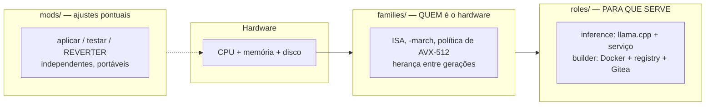
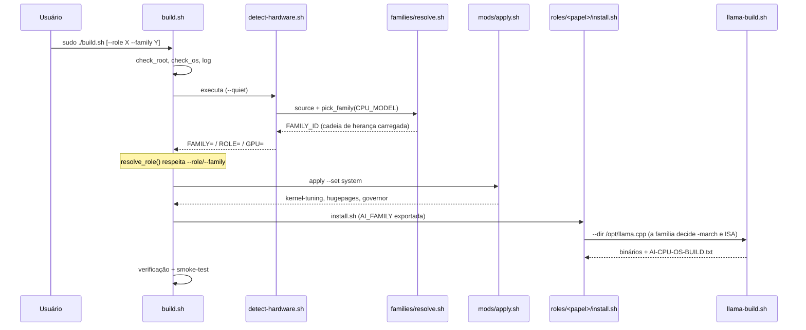

# README técnico — ai-cpu-os (manual do mantenedor)

> **Para quem é este documento:** quem vai **mexer no projeto** — adicionar uma
> família de CPU, criar um papel, escrever uma mod, ajustar o CI ou depurar uma
> falha. Para o **uso**, veja o [`README.md`](README.md). Para as **regras
> obrigatórias** e o fluxo de trabalho (inclusive de IAs), veja
> [`AGENTS.md`](AGENTS.md).
>
> **Última atualização:** 2026-10-12

---

## 0. Antes de tudo: onde cada documento vive

Há sobreposição entre os documentos. Para você não ler duas vezes nem editar no
lugar errado:

| Documento | É a fonte da verdade sobre | Atualize quando |
|---|---|---|
| **[`README.md`](README.md)** | uso do sistema, pelo usuário final | mudar a interface voltada ao usuário (`--role`, `--gpu`, paths, passos) |
| **este arquivo** | como o projeto funciona **por dentro** e como manter | mudar invariantes, contratos, CI, ou o passo a passo de estender |
| [`AGENTS.md`](AGENTS.md) | regras **obrigatórias** de trabalho + árvore + índice | criar/renomear arquivo, mudar uma regra |
| [`docs/ARCHITECTURE.md`](docs/ARCHITECTURE.md) | diagramas e fluxos visuais | mudar o desenho do fluxo entre componentes |
| [`docs/STATE.md`](docs/STATE.md) | o que está provado **hoje** + próxima ação | **ao fim de toda** sessão |
| [`docs/JOURNAL.md`](docs/JOURNAL.md) | histórico de sessões, threads abertas, armadilhas | **ao fim de toda** sessão |
| [`docs/TUNING.md`](docs/TUNING.md) | a justificativa técnica de cada ajuste | mudar/adicionar um ajuste |
| [`docs/VALIDATION.md`](docs/VALIDATION.md) | o protocolo de teste em hardware | adicionar uma área que precisa de validação manual |

**Regra prática:** se você está escrevendo *como fazer* → este arquivo ou
`AGENTS.md`. Se está escrevendo *o que aconteceu* → `JOURNAL.md`. Se está
escrevendo *o que já foi provado* → `STATE.md`.

---

## 1. Modelo mental: três camadas + uma separação

Todo o projeto sai de **duas decisões de arquitetura**. Entenda-as e o resto é
consequência.

### 1.1 As três camadas



| Camada | Pergunta que responde | Consequência de projeto |
|---|---|---|
| `families/` | *Quem é o hardware?* | `-march` e ISA. Uma família cobre **dezenas de modelos**; há **herança** entre gerações. |
| `roles/` | *Para que serve a máquina?* | Software e serviço. **Nunca** contém ISA. |
| `mods/` | *Qual ajuste pontual?* | Cada uma é aplicável **e reversível** isoladamente. |

**A fronteira que não pode vazar:** ISA fica na família; software fica no papel.
Se você se pegar escrevendo `-march` dentro de um `roles/*/install.sh`, parou no
lugar errado. O build do llama.cpp é **compartilhado** na raiz
(`llama-build.sh`) exatamente para não haver duas implementações de ISA.

### 1.2 A separação que evita mentira: *duas provas* para a ISO

Este é o erro conceitual mais fácil de cometer. "A ISO está verificada" **não
significa** "a ISO funciona":

| Ferramenta | Prova | Como | Custo |
|---|---|---|---|
| `iso/verify-iso.sh` | **conteúdo** | lê a ISO (ou uma árvore com `--dir`) e confere config, projeto, tokens, YAML, boot, Volume ID | segundos |
| `iso/test-vm.sh` | **comportamento** | boota em qemu, instala e observa o 1º boot | 10–60 min |

A mesma ideia aparece no build do llama.cpp: `build-llama` do CI **executa** os
binários e roda **inferência real** com um modelo minúsculo. Não basta compilar:
tem de rodar (foi assim que o bug de RPATH apareceu).

> **Padrão do projeto:** *toda* afirmação de "funciona" precisa de um teste que
> a exercite. Se não existe teste, a afirmação vai para `STATE.md` como "não
> validado" — sem eufemismo.

---

## 2. Mapa do repositório

```text
ai-cpu-os/
├── README.md               # usuário final
├── README.technical.md     # ← este arquivo (mantenedor)
├── AGENTS.md               # regras obrigatórias + árvore + índice
├── Makefile                # atalhos locais (espelham o CI)
├── build.sh                # ORQUESTRADOR: mods 'system' + papel
├── detect-hardware.sh      # SÓ LEITURA: relata e emite FAMILY=/ROLE=/GPU=
├── llama-build.sh          # compila o llama.cpp para a FAMÍLIA (compartilhado)
│
├── families/               # 🧬 QUEM é o hardware
│   ├── README.md
│   ├── resolve.sh          # o "cérebro": pick_family/load_family/compute_isa
│   ├── _base/family.conf   # padrões herdados por todos
│   ├── intel-haswell/  intel-broadwell/  intel-skylake-avx512/
│   ├── amd-zen1/ amd-zen2/ amd-zen3/ amd-zen4/
│   └── generic/            # fallback x86-64
│
├── roles/                  # 🎯 PARA QUE SERVE
│   ├── README.md
│   ├── inference/          # install.sh, ai-server.service, shell-ia.py, sysctl.conf
│   └── builder/            # install.sh, docker-setup.sh, registry-setup.sh,
│                           # gitea-compose.yml, build-runner.sh
│
├── mods/                   # 🔧 ajustes pontuais e reversíveis
│   ├── README.md
│   ├── apply.sh            # motor: list|info|check|apply|revert|test
│   ├── kernel-tuning/  hugepages/  governor/  openblas-threads/
│   │   └── (cada uma: mod.conf + apply.sh + revert.sh)
│
├── iso/                    # 🎯 ENTREGÁVEL FINAL
│   ├── build-iso.sh        # remasteriza (--distro ubuntu|debian)
│   ├── verify-iso.sh       # prova o CONTEÚDO (--iso ou --dir)
│   ├── test-vm.sh          # prova o COMPORTAMENTO (qemu + console serial)
│   ├── write-pendrive.sh   # grava num pendrive (9 travas; o passo mais perigoso)
│   ├── check-iso.sh        # confere uma ISO BAIXADA sem xorriso (dd/od/sha256)
│   ├── autoinstall/autoinstall.yaml   # config do Ubuntu (padrão)
│   └── preseed/            # templates compartilhados + legado Debian
│       ├── ai-cpu-os.cfg       # (só Debian)
│       ├── late-command.sh     # compartilhado (d-i e Subiquity)
│       ├── firstboot.sh        # compartilhado — aplica no 1º boot
│       └── ai-cpu-os-firstboot.service
│
├── tests/
│   ├── smoke-test.sh       # verificação pós-build (no alvo)
│   ├── test-families.sh    # casamento CPU → família (sem hardware)
│   ├── test-iso-selection.sh # escolha da ISO oficial no SHA256SUMS
│   ├── test-iso-repo-filter.sh # repo apt: filtro + fallback (stubs)
│   ├── test-verify-iso-repo-distro.sh # verificador distro-aware (autoinstall × preseed)
│   ├── test-ci-guards.sh   # os guardas do CI reprovam mesmo?
│   ├── test-write-pendrive.sh # as travas do pendrive (alvo = ARQUIVO)
│   ├── test-check-iso.sh   # conferência de ISO baixada (fixtures byte a byte)
│   ├── test-webui.sh       # interface web: API + salvaguardas (sem navegador)
│   ├── fixtures/           # SHA256SUMS reais + saída real do apt-cache
│   └── families-matrix.txt # ~60 CPUs reais → família esperada
│
├── webui/                  # interface web local (conveniência, não um 2º caminho)
│   ├── server.py           # só stdlib: lista branca + validadores + SSE
│   └── index.html          # página única, sem CDN (funciona offline)
│
├── docker/                 # Dockerfile + exemplo de compose
├── docs/                   # ver a tabela do § 0
└── .github/workflows/      # validate, build-llama, container, iso
```

---

## 3. Fluxo de execução (o que acontece quando alguém roda `build.sh`)



**Detalhes que importam:**

- `detect-hardware.sh` **delega** a família ao `resolve.sh` — não reimplementa
  casamento. Ele continua sendo o único lugar que lê SMBIOS/canais de disco.
- `resolve.sh` é carregado por **`source`** (não executado) por três scripts.
  Isso impõe uma restrição: **não usar `readonly` com nome genérico** (ver § 8).
- `build.sh` exporta `AI_FAMILY`, e `llama-build.sh` a consome como padrão de
  `--family`. Assim o papel não precisa passar família adiante.
- O `firstboot.sh` da ISO chama `build.sh --role ... --family ... --yes` — ou
  seja, **o mesmo caminho** do uso manual. Se você quebrar `build.sh`, quebra a
  ISO.

---

## 4. Contratos e invariantes (o que NÃO pode quebrar)

Estes são os pontos que, se violados, quebram de forma silenciosa e cara.

### 4.1 Portabilidade do binário

| Invariante | Por quê |
|---|---|
| `GGML_NATIVE=OFF` é o **padrão** | `GGML_NATIVE=ON` compila para a máquina que compila. Se for o runner do CI (que pode ter AVX-512), o binário sofre **`SIGILL`** nos alvos reais (que têm só AVX2). |
| Cross-build usa `--assume-family-isa` | Sem isso, a decisão de ISA consulta o `/proc/cpuinfo` de quem compila, não do alvo. |
| Nada de `-mavx512*` fixo | Só entra via política da família + opt-in (`--allow-avx512`). |
| Container mantém `GGML_NATIVE=OFF` | Dentro do Docker, o CMake detectaria a CPU do **runner**, não a do usuário. |
| Nunca `COPY build/bin` no Dockerfile | O llama.cpp usa `BUILD_SHARED_LIBS=ON` e os binários têm RPATH absoluto → `exit 127`. Use `cmake --install` + `CMAKE_INSTALL_RPATH=/usr/local/lib` + `ldconfig`. |
| `--source <dir|tar.gz>` **nunca** pode exigir rede ou `git` | É o único caminho de build **offline** (ISO air-gapped, Regra 13-b). Ao mexer nele, teste as duas formas em `--dry-run` **e** de verdade (a extração remove o diretório de topo do tarball). |

### 4.2 Mods

| Invariante | Por quê |
|---|---|
| Toda mod **reverte** | É a definição de mod. Sem `revert.sh` funcional, não entra. |
| Toda mod é **idempotente** | Rodar duas vezes não pode duplicar bloco/linha. Use marcadores `# >>> ai-cpu-os: <id> >>>`. |
| Toda mod aceita `--dry-run` | O usuário precisa poder olhar antes. |
| Backup antes de editar arquivo de sistema | `cp -a arquivo arquivo.bak.$(date +%s)`. |
| `MOD_*` no `mod.conf` são o contrato | `MOD_RISK`, `MOD_REBOOT`, `MOD_REQUIRES`, `MOD_FAMILIES`, `MOD_ROLES`, `MOD_SETS`, `MOD_ORDER`. |

### 4.3 Famílias

| Invariante | Por quê |
|---|---|
| `FAMILY_MATCH_NAME` não rouba CPU de outra família | Um regex largo manda a máquina para a família errada. Só o corpus (§ 6) pega isso. |
| Toda família com `FAMILY_MARCH` tem `FAMILY_MARCH_MIN_GCC` + fallback | GCC antigo **rejeita** a flag e o build quebra em vez de degradar. |
| `FAMILY_AVX512_POLICY=auto` só em `generic` | `auto` liga sem perguntar; em família específica isso é perigoso. |
| `resolve.sh` referencia só `FAMILY_*` / `RESOLVE_*` | Ele é "sourced": nomes genéricos colidem com o chamador. |

### 4.4 ISO

| Invariante | Por quê |
|---|---|
| A config de instalação **tem** de chegar na ISO | Sem `/autoinstall.yaml` (Ubuntu) ou `/preseed/ai-cpu-os.cfg` (Debian), a instalação deixa de ser automática — e o usuário descobre só no meio do processo. |
| Nenhum `@@TOKEN@@` pode sobrar | Um token não substituído gera comportamento indefinido no instalador. |
| Senha **só** como hash crypt | Nunca texto puro numa mídia. |
| Tuning acontece no **1º boot**, nunca no late-command | Durante a instalação não há systemd do alvo, o kernel é outro e o hardware real não está visível. Detalhes: `docs/ISO.md` § 3. |
| O template do `autoinstall.yaml` **não** é YAML válido | O `@` é indicador reservado do YAML. Só o arquivo **substituído** é validável — por isso existe o autoteste. |
| **Air-gapped: nenhum passo pode exigir rede** | Decisão firmada (`docs/ISO.md` § 3.1). Se você introduzir um download num script, papel ou template, **embuta-o na mídia** ou torne-o explicitamente opcional com aviso. |
| **Nunca embutir binário pré-compilado do llama.cpp** | Seria mais rápido, mas exigiria **uma ISO por família** e reintroduziria o risco de `SIGILL`. Compilar no 1º boot é o que garante o `-march` da família **realmente detectada**. Há guardas **negativos** no CI (`--prebuilt`, `COPY build/bin`). |
| O `llama-build.sh` deve manter `--source <dir|tar.gz>` | É o único caminho de build **sem rede e sem git**. Se ele sumir, a ISO volta a depender de internet. Há guarda no CI. |
| A corrente da **fonte** não pode quebrar | `--iso-source` → `/llama-src.tar.gz` → `LLAMA_SRC` (`.iso-config`) → `AI_LLAMA_SOURCE` (env) → `llama-build.sh --source`. Se um elo sumir, o 1º boot volta a **clonar** o llama.cpp — e o modo de falha é silencioso. Cada elo tem guarda no CI e checagem no `verify-iso.sh`. |
| `build.sh` precisa de `--model-file`/`--llama-source` | `sudo` **limpa o ambiente**: sem as flags não haveria como usar os caminhos offline na mão. O `firstboot.sh` usa as variáveis (não há `sudo` no meio). |
| A corrente do modelo na mídia não pode quebrar | `--iso-model` (build) → `/models/<arquivo>` (mídia) → `MODEL_FILE` (`.iso-config`) → `AI_MODEL_FILE` (env) → `--model-file` (papel). Se qualquer elo sumir, o modo de falha é **silencioso**: o sistema sobe sem LLM e ninguém percebe. Cada elo tem guarda no CI e checagem no `verify-iso.sh`. |
| O repositório apt local entra como fonte **EXTRA**, nunca como `primary` | Como `primary`, o `sources.list` do **sistema instalado** apontaria para `file:///cdrom/...` (morto após a instalação) e um repositório incompleto **abortaria** a instalação. Como fonte extra, o alvo nasce com o espelho oficial e um repo incompleto **degrada** para a rede. |
| Repositório de release diferente da ISO | Os `.deb` de outra release têm versões que não casam com a base e a instalação quebra **tarde**. O build compara o codename de `/etc/os-release` com o da URL da ISO e **recusa** (escape: `--iso-repo-allow-mismatch`). |

### 4.5 Convenções de Bash (cobradas pelo CI)

- Todo script Bash: `set -euo pipefail`.
- Exceção única: POSIX `sh` que roda **dentro do instalador** usa `set -eu`
  (o `/bin/sh` do debian-installer é dash, sem `pipefail`) —
  `iso/preseed/late-command.sh`. O guarda do CI distingue por shebang.
- `--dry-run`, `--yes`, idempotência e confirmação antes de ação destrutiva.

---

## 5. Como estender (receitas)

### 5.1 Adicionar uma família de CPU

```bash
mkdir -p families/amd-zen5
$EDITOR families/amd-zen5/family.conf     # ver template abaixo
bash build.sh --list-families             # apareceu?
bash tests/test-families.sh               # não quebrou o corpus?
bash tests/test-iso-selection.sh          # a escolha da ISO oficial ainda está certa?
bash tests/test-iso-repo-filter.sh        # o repo apt não perde lote em silêncio?
bash tests/test-verify-iso-repo-distro.sh # o verificador entende as duas distros?
bash tests/test-ci-guards.sh              # os guardas do CI reprovam mesmo?
bash tests/test-check-iso.sh              # a conferência de ISO baixada acerta?
bash tests/test-webui.sh                  # a interface web continua contida?
```

`family.conf` mínimo:

```bash
FAMILY_ID="amd-zen5"
FAMILY_NAME="AMD Zen 5 (Ryzen 9000, EPYC Turin)"
FAMILY_VENDOR="amd"
FAMILY_ARCH="x86_64"
FAMILY_INHERITS="amd-zen4"                       # herda o tuning anterior
FAMILY_MARCH="-march=znver5 -mtune=znver5"
FAMILY_MARCH_MIN_GCC="14"                        # GCC que conhece znver5
FAMILY_MARCH_FALLBACK="-march=znver4 -mtune=znver4"
FAMILY_ISA_REQUIRED="avx avx2 fma f16c"
FAMILY_ISA_OPTIONAL="avx512f avx512vnni"
FAMILY_AVX512_POLICY="optin"
FAMILY_MATCH_NAME="Ryzen .* (9[0-9]{3}|1[0-9]{4})|EPYC [0-9]{3}5"
FAMILY_CPUID_HINT="family 26 (0x1A)"
FAMILY_NOTES="..."
```

**Checklist obrigatório** (o CI cobra parte disso):

1. Adicione ao corpus em `tests/families-matrix.txt` **pelo menos 3 modelos
   reais** da família (e rode `make families-test`).
2. Adicione `families/<id>/family.conf` à lista `required` do workflow
   `validate.yml`.
3. Se ela tem AVX-512, a política é `optin` — **nunca** `auto`.
4. Adicione à tabela de `docs/FAMILIES.md` § 2 **e** à tabela do `AGENTS.md § 4`.
5. Se for interessante compilar no CI, adicione ao `matrix` de
   `build-llama.yml`.
6. ⚠️ **Ao escrever o regex**, cuidado com espaço duplo: `EPYC .* [0-9]{3}1`
   **não** casa `"EPYC 7601"` (o `"EPYC "` já consome o espaço). Use
   `EPYC [0-9]{3}1`. Esse erro deixou **todos** os EPYC em `generic`.

### 5.2 Adicionar um papel

```bash
mkdir -p roles/meu-papel
$EDITOR roles/meu-papel/install.sh     # deve aceitar --dry-run e --yes
```

1. `install.sh` recebe `--dry-run`/`--yes` do `build.sh` (veja `child_flags`).
2. Se o papel precisar do llama.cpp, chame **`${REPO_ROOT}/llama-build.sh`**
   (nunca reimplemente flags de ISA).
3. Registre o papel em `choose_role()` (`detect-hardware.sh`) se ele deve ser
   detectado automaticamente — hoje: Xeon/EPYC → `inference`; senão por RAM.
4. Adicione ao `matrix` do job `dry-run` em `validate.yml`
   (`role: [inference, builder, meu-papel]`).
5. Adicione ao `chmod +x` do CI e à lista `required`.
6. Documente em `roles/README.md`, `AGENTS.md § 4` e no `README.md` (tabela de papéis).

### 5.3 Adicionar uma mod

```bash
mkdir -p mods/minha-mod
$EDITOR mods/minha-mod/mod.conf
$EDITOR mods/minha-mod/apply.sh      # set -euo pipefail, --dry-run, idempotente
$EDITOR mods/minha-mod/revert.sh     # desfaz exatamente o que apply fez
chmod +x mods/minha-mod/*.sh
bash mods/apply.sh info minha-mod
bash mods/apply.sh apply minha-mod --dry-run
bash mods/apply.sh revert minha-mod --dry-run
bash mods/apply.sh test minha-mod    # container (se docker disponível)
```

Estrutura do `apply.sh` (copie de `mods/openblas-threads/`): parse de
`--dry-run`/`--yes` → checagem de root → **1)** já aplicado? sai 0 →
**2)** dry-run? imprime e sai → **3)** backup → aplica → confirma.

Depois: adicione à tabela de `docs/MODS.md`, ao `mods/README.md`, à lista
`required` do CI e ao laço do "desfazer tudo" no `README.md` § 9.

### 5.4 Adicionar um teste

| Tipo | Onde | Precisa de |
|---|---|---|
| Unidade/lógica pura (sem hardware) | `tests/` + um passo no job `lint` ou `dry-run` | nada — **é o tipo preferido** |
| Verificação de conteúdo | padrão do `iso/verify-iso.sh --dir` | uma árvore/saída montada |
| Comportamento real | padrão do `iso/test-vm.sh` | qemu/hardware (não roda no CI padrão) |

**Regra:** prefira o teste que roda em qualquer lugar. O `verify-iso.sh` só tem
o modo `--dir` porque isso o tornou executável no CI — **e foi isso que fez ele
derrubar um bug do próprio verificador** (a checagem de `ROLE` exigia
`@@ROLE@@`, isto é, exigia o que a substituição remove).

### 5.5 Adicionar um passo ao CI

1. Edite o arquivo em `.github/workflows/`.
2. **Reproduza localmente** com `make` (adicione o alvo, se não existir).
3. Atualize `docs/CI.md` (Regra 11 do `AGENTS.md`).
4. Se o passo verifica algo que não pode regredir, adicione um **guarda** com
   `grep -q` no job `project-rules` (ex.: proibir que `--gpu auto` volte a
   existir).

---

## 6. Testes: o que cada um prova (e o que não)

| Comando | Prova | **NÃO** prova |
|---|---|---|
| `make bashn` | sintaxe de todos os `.sh` | nada além de sintaxe |
| `make shellcheck` | erros prováveis de Bash | lógica de negócio |
| `make python` | `shell-ia.py` compila | que ele funciona |
| `make yaml` | YAML válido (os que **são** YAML) | semântica |
| `make iso-lint` / `make iso-yaml` | templates substituídos + verificador + **teste negativo** | que a ISO boota |
| `make families-test` | **casamento** CPU → família (corpus de ~60 CPUs) | ISA e `-march` em execução |
| job `dry-run` | orquestração nos dois papéis, sem alterar nada | efeito real dos ajustes |
| job `build-llama` | compila **e executa** os binários + inferência real | desempenho; e só para as famílias na matriz |
| `iso/verify-iso.sh --iso` | conteúdo da ISO real | comportamento |
| `iso/test-vm.sh` | boot + instalação + 1º boot | nada além do que os marcadores cobrem |

**A lacuna estrutural que você deve conhecer:** nenhum teste do CI exercita o
**efeito** dos ajustes de kernel (governor, C-states, huge pages, sysctl). Isso
exige host privilegiado e, para C-states, **reboot**. Está em
`docs/VALIDATION.md` (blocos A–P) e é trabalho manual por natureza.

---

## 7. CI/CD por dentro

| Workflow | Dispara em | O que realmente faz |
|---|---|---|
| `validate` | todo push/PR | job `lint` (bash -n, shellcheck, compileall, yamllint, iso-lint+autoteste, families-test), job `dry-run` (matriz de papéis), job `project-rules` (arquivos obrigatórios + campos de docs + guards) |
| `build-llama` | manual, tags `v*`, semanal | matriz de famílias; compila com `--assume-family-isa`, **executa** os binários, roda **inferência real** com um `.gguf` minúsculo, empacota `.tar.gz` e (em tags) anexa à Release |
| `container` | push em `main`, tags, PR em `docker/**` | publica no GHCR: `:latest` (portável) e `:znver2` |
| `iso` | manual, tags `v*` | gera a ISO, anexa artefato e (em tags) à Release |

**O job `project-rules` é o guarda-corpo do projeto.** Ele verifica:

1. **Arquivos obrigatórios** existem (se você renomear algo, **atualize a
   lista** — senão o CI fica vermelho).
2. **Campos de documentos vivos** (`STATE.md` tem "Próxima ação imediata";
   `VALIDATION.md` continua preenchível; `JOURNAL.md` mantém as seções).
3. **Guards de regressão** — asserções negativas do tipo "isso não pode voltar",
   por exemplo: o `firstboot.sh` tem de manter `@@ROLE@@`/`@@FAMILY@@`; o
   `llama-build.sh` **não** pode conter `--gpu auto`; as ferramentas da ISO têm
   de existir e estar ligadas ao Makefile.

**Reproduzir tudo localmente** (o hábito que evita surpresa no PR):

```bash
export PATH="$HOME/.local/bin:$PATH"   # shellcheck/yamllint instalados aqui
make validate        # = job 'lint' + docs + families-test + iso-select-test
make ci              # validate + dry-run
make iso-yaml        # autoteste das ferramentas da ISO (com teste negativo)
bash tests/test-families.sh
bash tests/test-iso-selection.sh     # escolha da ISO oficial (sem rede)
bash tests/test-iso-repo-filter.sh   # repo apt: filtro e fallback (sem rede)
bash tests/test-verify-iso-repo-distro.sh # verificador distro-aware (sem xorriso)
bash tests/test-ci-guards.sh         # os guardas do CI reprovam? (cópia temporária)
bash tests/test-check-iso.sh         # conferência de ISO baixada (sem xorriso)
bash tests/test-webui.sh             # interface web: API + salvaguardas
```

> **Sem `gh`/token, a API do GitHub é limitada a 60 req/h.** Não faça polling
> agressivo — esgota a cota e você fica sem diagnóstico. Prefira rodar
> localmente.
>
> Detalhe útil: **os logs de job exigem token (403), mas as ANOTAÇÕES são
> públicas** (`/check-runs/<job_id>/annotations`). É por isso que o `iso.yml`
> tem um passo de diagnóstico em falha: ele converte os erros do log em
> anotações, que dá para ler de fora do repositório.

---

## 8. Depurar: os problemas já vistos e como diagnosticar

Esta seção é um **playbook**. Todos os itens abaixo aconteceram de verdade.

### 8.1 Build do llama.cpp

| Sintoma | Causa raiz | Correção |
|---|---|---|
| CMake falha em `find_package(PkgConfig)` | Faltava `pkg-config` (o backend BLAS usa) | `apt install pkg-config` (já nos 3 lugares: Dockerfile, `check_deps`, install do papel) |
| Container: `exit code 127` | `BUILD_SHARED_LIBS=ON` + RPATH absoluto → `COPY build/bin` quebra o loader | `cmake --install` + `CMAKE_INSTALL_RPATH=/usr/local/lib` + `ldconfig` |
| `SIGILL` na máquina do usuário | Binário compilado para outra CPU (native/cross-build sem `--assume-family-isa`) | Recompilar com `--family <correta>` |
| Flag `-march` rejeitada pelo GCC | GCC velho demais para o `-march` da família | O `resolve.sh` já cai para `FAMILY_MARCH_FALLBACK` (confira o aviso) |
| `tar -xf` "extraiu" mas o CMake não acha o projeto | O tarball do GitHub tem **diretório de topo** (`llama.cpp-<ref>/`) | O `--source` já entra nesse diretório automaticamente (glob, não `find \| head` — com `pipefail` o SIGPIPE do `head` reprovaria a extração) |

> **Lição registrada:** *lint verde ≠ build comprovado*. Os dois primeiros bugs
> acima só apareceram porque o CI **executa** o que compila.

### 8.2 Scripts e `source`

| Sintoma | Causa raiz | Correção |
|---|---|---|
| `readonly variable` ao carregar `resolve.sh` | Nome de variável genérico (`SCRIPT_DIR`, `FAMILIES_DIR`) já definido pelo chamador | Prefixar (`RESOLVE_FAMILIES_DIR`) |
| Variável "some" sem explicação | `HOSTNAME` é **builtin do bash**; sobrescrevê-la confunde | Usar outro nome (`SYS_HOSTNAME`) |
| Argumento do CMake corrompido com texto de log | `$(função)` capturou também o `log_info` (que escreve em stdout) | Separar: uma função **só** imprime a flag; o log sai por fora |
| `shellcheck SC2254` em `case $LISTA` | Padrão de `case` com expansão vira glob | Comparar em laço, ou citar |
| `shellcheck SC2054` em array do qemu | As vírgulas (`user,id=net0`) parecem separador | Citar os valores: `-netdev "user,id=net0"` |

### 8.3 Casamento de família (o mais traiçoeiro)

| Sintoma | Causa raiz | Como detectar |
|---|---|---|
| Máquina cai em `generic` "sem motivo" | Regex com espaço duplo (`EPYC .* [0-9]{3}1`) ou geração ausente (`8[0-9]{3}`) | `make families-test` — **só ele pega**, porque o build *funciona* com `generic`, apenas sem `-march` |
| CPU moderna numa família errada | `FAMILY_MATCH_NAME` de uma família anterior casou primeiro | A ordem em `pick_family` é do mais específico para o mais genérico |

### 8.4 ISO

| Sintoma | Causa raiz | Como detectar |
|---|---|---|
| Instalador pergunta tudo | Config não chegou na ISO, ou o menu não a escolheu | `make iso-verify ISO=...` (confere `/autoinstall.yaml` e a entrada de boot) |
| `exit code 22` no `build-iso.sh` | É código do **`curl`** (HTTP ≥ 400 sob `-f`), não do script. Caso real: o `SHA256SUMS` do Ubuntu marca o modo binário com `*` e o `*` ia para a URL → **404** | A URL sai no log (`Baixando <url>`); confirme com `curl -sIL -o /dev/null -w '%{http_code}'` |
| `Pacote pedido está AUSENTE no repositório: X` | `apt-get download a b c` **aborta o lote inteiro** se um nome não tiver candidato (pacote virtual). O `|| true` engolia até 25 pacotes por lote | `make iso-repo-test` reproduz o caso offline |
| Um guarda do CI "não reprova" quando você planta a violação | Guarda na forma `! cmd`: o `set -e` **ignora** o status de comandos invertidos com `!` | `make ci-guards-test` planta as violações e exige que o job falhe |
| A ISO **Debian** é reprovada pelo verificador, mas está correta | O `verify-iso.sh` procurava o repo em uso **só no autoinstall** — que não existe no Debian (que usa preseed). Falso positivo | `make iso-verify-test` roda o verificador nas duas distros, e falha se voltar o viés |
| `openssl não encontrado` no build da ISO | Dependência **implícita do runner**: o build usa `openssl passwd -6` e o workflow não o instalava. Descobri num container `ubuntu:24.04` limpo | O workflow agora instala `openssl`, `gzip` e `ca-certificates` |
| O run da ISO falha **depois** de gerar a ISO, com `exit 127` | Uma mensagem de aviso tinha a linha partida: a 2ª linha virava **comando solto** (`command not found`). Só aparecia com ISO > 2 GiB (o caso air-gapped) | Monte a mensagem numa **variável**; nunca deixe string solta no `run: \|` |
| A ISO air-gapped é gerada mas **não dá para baixar** | O mesmo booleano gateava artifact **e** Release. O limite de 2 GiB é de **asset de Release**; artifact não tem esse limite (só nº por job e perda de permissões) | O artifact sobe **sempre**; só a Release é gateada (`release_too_big`). Há guarda no CI |
| Baixei o artifact e o arquivo **não é uma ISO** | O navegador entrega o artifact, que é um **`.zip`** — renomeou para `.iso` não resolve | `make iso-check ISO=...` detecta (falta a assinatura `CD001`) e diz para descompactar |
| `test-vm.sh` "não vê nada" do 1º boot | Faltou `--serial-console` no build (o `console=ttyS0` não entrou no sistema instalado) | O próprio script avisa; gere a ISO com a flag |
| `yamllint` reprova o template do autoinstall | O `@` de `@@TOKEN@@` é reservado no YAML — **esperado** | Use `make iso-yaml` (valida o arquivo **substituído**) |
| `xorriso -map` reclama de um caminho | Arquivo opcional inexistente na ISO base | Confira a extração em `prepare_ubuntu` (ex.: `/EFI/boot/grub.cfg`) |

### 4.5 Guardas do CI

| Invariante | Por quê |
|---|---|
| Guarda negativo **nunca** na forma `! cmd` | O `set -e` ignora o exit status de um comando invertido com `!` — o guarda **existe, detecta e não derruba nada**. Seis guardas deste repo estavam assim. Use `if cmd; then echo "::error::..."; exit 1; fi`. |
| Todo guarda tem de ser **provado** | `make ci-guards-test` planta cada violação numa cópia temporária e exige que o job falhe. Guarda que nunca reprovou não é guarda. |
| Guarda por `grep` de nome solto é fraco | `grep 'funcao'` casa `funcao_velha`. Ancore na definição (`^funcao()`). |
| Não **contar** ocorrências varrendo `*.yml` | O próprio `validate.yml` cita os padrões dentro dos comandos; a contagem infla e a perda de um arquivo passa batido. Prefira uma asserção por arquivo. |
| Todo comando do CI é um **alvo do Makefile**, e o CI **chama o alvo** | Comando duplicado diverge: foi assim que o `validate` ficou vermelho no `main` por duas sessões com o `make validate` local verde. |

### 4.6 Pendrive (`iso/write-pendrive.sh`)

Este é o passo mais perigoso do projeto: `dd` no dispositivo errado apaga o
disco errado, sem desfazer. As travas são o produto — o `dd` é consequência.

| Invariante | Por quê |
|---|---|
| Nunca escrever no disco que contém `/` | Nada sobrescreve o sistema em uso |
| Recusar disco **não removível** sem `--allow-internal` | SATA/NVMe interno tem de ser difícil de acertar por engano |
| Recusar quem não for **disco inteiro** (`TYPE=disk`) | Um `sr0` (DVD) tem `RM=1` e passaria como "removível"; partição e loop também não servem |
| Recusar se houver partição **montada** | Gravar com o pendrive montado corrompe |
| Conferir a assinatura `CD001` (ISO 9660) | O alvo não pode ser um arquivo qualquer |
| Conferir que a ISO **cabe** no dispositivo | E **avisar** se o dispositivo for muito maior (sinal de alvo errado) |
| `--yes` **nunca** pula as travas acima | Só pula a digitação do nome do dispositivo |
| **Ler de volta** e comparar (`cmp -n`) | Gravar sem conferir é fé, não engenharia. `conv=fsync` antes de conferir |
| O teste **nunca** toca um dispositivo | `make pendrive-test` grava num **arquivo** e exercita as funções de trava com um `lsblk` simulado |

### 4.7 A interface web (`webui/`) — conveniência, nunca um 2º caminho

A UI existe para quem não quer decorar flags. Todo o risco dela é **crescer sem
disciplina** e virar um segundo cérebro do projeto (com regras próprias, que
divergem). Estes invariantes são o que a impede:

| Invariante | Por quê |
|---|---|
| **Só executa o que está na lista branca** (`ACTIONS`) | A UI **nunca** aceita comando, caminho de script ou nome de alvo vindo do navegador. Ela monta a linha de comando a partir de valores **validados** (`v_disk`, `v_family`, `v_distro`, …) e chama **alvos do `Makefile`** que já existem e já são testados. |
| **Escuta só em `127.0.0.1`** e recusa outra interface | Amarrar em `0.0.0.0` exporia, na rede, uma página que gera ISO e escolhe disco para particionar. |
| **Somente biblioteca padrão** | `pip install` não pode ser pré-requisito para gerar a ISO numa máquina limitada. Nada de `fastapi`/`flask`/`requests`. |
| **Nunca lida com senha** | Gravar pendrive exige root; a UI só **lista** os dispositivos e mostra o comando `sudo make pendrive …` pronto. Senha nunca entra no navegador, no servidor ou em log. |
| **Não tem rota de escrita arbitrária** | Se um dia precisar, é decisão de arquitetura — não um atalho. |
| **Não fica tentando o impossível** | Sem `xorriso`, ela **recusa** com o motivo explícito e aponta o GitHub Actions (Regra 13-a: degradar com aviso, nunca falhar em silêncio). |
| **A ISO não leva o `webui/`** | `--exclude=./webui` no `build-iso.sh`: é ferramenta da máquina que **gera** a mídia, não do sistema instalado (Regra 13-b). |
| **Não depende de CDN** | Um `<script src="https://…">` quebraria a página justamente na máquina offline. A página é HTML+CSS+JS inline. |

Cada linha acima tem guarda no CI e um **caso negativo** provado em
`tests/test-ci-guards.sh` (planta a violação e exige que o job falhe).

⚠️ **O que não foi provado:** a UI é exercitada **pela API** (`make ui-test`,
34 asserções — lista branca, validadores, SSE, recusa sem `xorriso`). **Nunca
foi aberta num navegador de verdade.** Se algo é puramente visual, ninguém
olhou.

### 4.8 Fluxo de trabalho (evita retrabalho)

- **`grep` sem arquivo no terminal bloqueia a sessão** (lê `stdin`). Sempre dê
  um arquivo ou um `path`.
- **`! grep ...` no terminal interativo** dispara *history expansion*
  (`event not found`) — é o shell, não o repositório. Em script, funciona.
- **Edição por bloco sem incluir a linha seguinte** pode grudar linhas. Confira
  com `git diff`.
- **Antes de abrir PR:** `make ci` verde. Nunca faça merge com CI vermelho.

---

## 9. Workflows de manutenção (receitas de rotina)

### 9.1 "Preciso saber em que estado o projeto está"

```bash
cd /home/juju/Deep_Rock_IA && git pull --ff-only
make validate                     # saúde geral
sed -n '/## 6. Próxima ação/,/## 7/p' docs/STATE.md   # o que fazer agora
grep -n '^### Sessão' docs/JOURNAL.md | tail -3       # últimas sessões
```

### 9.2 "Vou mexer em algo e quero o caminho completo"

1. Leia `docs/STATE.md` § 6 e `docs/JOURNAL.md` § 5 (threads abertas).
2. Faça a mudança.
3. `make validate` (+ `make iso-yaml` / `make families-test` conforme a área).
4. Atualize conforme a área: `docs/STATE.md` § 6, `docs/ROADMAP.md`,
   `docs/JOURNAL.md` (sessão + threads + armadilhas), e o doc da área
   (`TUNING.md`, `FAMILIES.md`, `MODS.md`, `GPU.md`, `ISO.md`…).
5. Se criou/renomeou arquivo: `AGENTS.md § 4` + lista `required` do CI.
6. Commit + push. Se mudou os jobs do CI, atualize `docs/CI.md`.

### 9.3 "Alguém reportou um bug"

1. Reproduza **no caminho do projeto** (script, não comando solto).
2. Pergunte-se: é bug, ou é **documentação incompleta**? (Aconteceu: o
   `--profile` obsoleto.)
3. Corrija a causa, não só o sintoma.
4. **Adicione um teste ou guarda** que falharia antes da correção — é isso que
   impede a regressão voltar. (Padrão do projeto: os dois bugs do CI, o guard da
   GPU, o corpus de famílias.)
5. Registre a armadilha em `docs/JOURNAL.md` § 6.

### 9.4 "Quero publicar uma versão"

1. `make ci` verde.
2. `docs/TUTORIAL.md` atualizado e coerente (Regras 9 e 10 — **obrigatório**).
   Nada pode ser declarado "concluído" com o tutorial desatualizado.
3. `docs/STATE.md` § 1 (versão) e § 6 (próxima ação) atualizados.
4. TAG `v*` → dispara `build-llama` (anexa `.tar.gz`) e `iso` (anexa a ISO).
5. ⚠️ Só chame a ISO de pronta depois de **bootá-la em VM** (`iso/test-vm.sh`).

---

## 10. Armadilhas já pisadas (resumo executável)

Cada linha é um erro real, com o custo que teve.

| Armadilha | Consequência | Regra derivada |
|---|---|---|
| `GGML_NATIVE=ON` no CI | `SIGILL` nos alvos reais | Padrão **portátil**; cross-build com `--assume-family-isa` |
| `COPY build/bin` na imagem | `exit 127` | `cmake --install` + RPATH + `ldconfig` |
| Faltar `pkg-config` | Build falha no BLAS | Está nos 3 lugares, com comentário explicando |
| `readonly` com nome genérico em script "sourced" | Script morre ao ser carregado | Prefixar variáveis globais de bibliotecas |
| Sobrescrever `HOSTNAME` | Comportamento estranho no bash | Não usar builtin como variável própria |
| `$(função)` devolvendo log junto | Argumento corrompido | Função que só ecoa o valor; log por fora |
| Regex de família com espaço duplo | CPU cai em `generic` e perde `-march` **em silêncio** | `make families-test` no CI |
| Verificador que nunca falha | Falsa segurança | **Teste negativo** obrigatório no autoteste |
| Documento citando comando que não existe | Usuário perde tempo | Guarda no CI + revisão de caminhos ao refatorar |
| `find \| head -1` com `set -o pipefail` | O SIGPIPE do `head` **reprova** a extração que deu certo | Glob (`"$dir"/*/`) em vez de pipe para "pegar um item" |
| Editar bloco **sem** incluir a linha seguinte | Duas linhas grudam (`grep x file # comentário`) e o texto/código fica corrompido | Confira sempre com `sed -n ...p` / `git diff` depois de editar |

---

## 11. Status de validação (o que é fato e o que é promessa)

Leia isto **antes** de afirmar que algo funciona.

| Área | Escrito | Verificado por ferramenta | Validado em hardware real |
|---|---|---|---|
| Scripts (sintaxe/lint) | ✅ | ✅ `make validate` | n/a |
| Casamento CPU → família | ✅ | ✅ corpus (~60 CPUs) | ⚠️ só nos 2 alvos |
| Build do llama.cpp | ✅ | ✅ CI compila **e executa** (7 famílias em ~4 que rodam no CI) | ❌ |
| Build **offline** (`--source`) | ✅ | ⚠️ `--dry-run` (dir + tarball) e extração real com ferramentas de build **simuladas**; **compilação real de um fonte do llama.cpp não executada** | ❌ |
| Modelo **embutido na ISO** (`--iso-model`) | ✅ | ✅ **validado num boot real (sessão #21)**: o `late-command` copiou para `/opt/models` e o 1º boot o usou via `AI_MODEL_FILE`, sem rede | ❌ (só na VM) |
| Repositório apt **na mídia** (`--iso-repo`) | ✅ | ✅ **validado (sessão #21, era bug)**: a seção `sources` do Subiquity **não funciona** (o curtin roda `apt-get update` num chroot sem `/cdrom`); agora o late-command carrega o repo para o **alvo** (`/opt/apt-repo`) e o 1º boot o usa — sem rede. ⚠️ O caminho **Debian** (`apt-setup/local0/*`) segue **suposição** | ❌ (só na VM) |
| Fonte **na mídia** (`--iso-source`) | ✅ | ✅ **validado num boot real (sessão #21)**: o llama.cpp foi compilado do tarball da mídia, sem rede (`/opt/llama.cpp/build/bin/llama-server`) | ❌ (só na VM) |
| Ajustes de kernel (mods) | ✅ | ⚠️ só `--dry-run`/sintaxe | ❌ |
| Revert das mods | ✅ | ⚠️ não exercitado de ponta a ponta | ❌ |
| Serviço de IA (`ai-server`) | ✅ | ❌ | ❌ |
| Papel `builder` (Docker/registry/Gitea) | ✅ | ❌ | ❌ |
| ISO (conteúdo) | ✅ | ✅ `verify-iso.sh` (com teste negativo) — **na ISO real: PASS=41/FAIL=0** | ❌ |
| ISO (boot/instalação, **Ubuntu**) | ✅ | ✅ **executado (sessão #21)**: `test-vm.sh` exit 0 — instalou sozinha e o 1º boot aplicou (`status=ok`, família `intel-haswell`) | ❌ (só na VM) |
| ISO (boot/instalação, **Debian**) | ✅ | ❌ **nunca executado** | ❌ |
| Boot **UEFI** da ISO | ✅ | ❌ nunca testado | ❌ |
| GPU (qualquer backend) | ✅ | ❌ | ❌ |

**Fonte da verdade atualizada:** `docs/STATE.md` § 2/§ 3 e a tabela por família
em `docs/FAMILIES.md` § 9.3. Se você melhorar qualquer linha desta tabela,
**atualize os dois** — e registre a sessão no `JOURNAL.md`.

---

## 12. Glossário

| Termo | Significado no projeto |
|---|---|
| **família** | Grupo de CPUs da mesma microarquitetura (ex.: `intel-broadwell` = Xeon E5 v4). Define `-march` e ISA. |
| **papel** | O que a máquina **faz**: `inference` ou `builder`. Nunca contém ISA. |
| **mod** | Ajuste pontual, aplicável e reversível isoladamente. |
| **perfil** | Termo **antigo** (substituído por família + papel). Sobrevive só como alias `--profile` e em ISOs antigas. |
| **cross-build** | Compilar para **outra** máquina (ex.: CI → usuário). Exige `--assume-family-isa`. |
| **política de AVX-512** | `never` (nunca), `optin` (só com `--allow-avx512`), `auto` (se a CPU tiver; só em `generic`). |
| **herança** | `FAMILY_INHERITS` encadeia famílias: corrigir a raiz corrige os descendentes. |
| **`--assume-family-isa`** | Faz a decisão de ISA vir do `family.conf` em vez do `/proc/cpuinfo` local. |
| **`--source`** | Compila de um fonte **local** (diretório ou tarball): sem rede, sem `git`. É o caminho do 1º boot numa ISO air-gapped; `--ref` e `--source` são exclusivos. |
| **`--iso-model`** | `auto` (baixa o modelo sugerido **na máquina de build** e embute), `none` (ISO sem modelo) ou o caminho de um `.gguf`. Validado antes de montar a ISO. |
| **`--iso-repo`** | `auto` (baixa os `.deb` do **fecho de dependências** e monta um repositório apt local na mídia, em `/apt-repo`), `none` ou um diretório com `.deb`. Recusa release diferente da ISO. |
| **fecho de dependências** | Conjunto fechado de pacotes que satisfaz os pedidos (`apt-cache depends --recurse`, sem recomendados/sugeridos). É o que garante que o alvo não precise buscar mais nada. |
| **`--iso-source`** | `auto` (baixa o tarball do llama.cpp e embute), `none` ou um `.tar.gz` seu. Sem ele, o 1º boot clonaria o GitHub. O `llama-build.sh` compila **do tarball** (extrai, trata o diretório de topo). |
| **`AI_LLAMA_SOURCE`** | Variável de ambiente exportada pelo `firstboot.sh` com o caminho do tarball no alvo. É o padrão de `--source` no `llama-build.sh` (mesmo padrão do `AI_FAMILY`/`AI_MODEL_FILE`). |
| **`--model-file` / `AI_MODEL_FILE`** | Instala um `.gguf` **local** (copiando para `/opt/models`), sem rede. É como o 1º boot da ISO usa o modelo que veio na mídia. |
| **air-gapped** | Sem rede — nem na instalação, nem no 1º boot. Objetivo firmado da ISO (`docs/ISO.md` § 3.1): o **fonte**, o **modelo** e o **toolchain** (repositório apt local) já vão na mídia, e o **1º boot foi provado sem rede** (sessão #21). |
| **`AI-CPU-OS-BUILD.txt`** | Registro ao lado dos binários: família, `-march`, ISA, AVX-512, GPU, ref. |
| **duas provas** | `verify-iso.sh` (conteúdo) × `test-vm.sh` (comportamento). Não se substituem. |
| **conjunto de mods** | `system` (o que o `build.sh` aplica) ou `portable` (seguras, uma a uma). |
| **sentinela** | Arquivo `.firstboot-pending`: enquanto existe, o serviço de 1º boot roda. |

---

## 13. Limites conhecidos do projeto (assuma-os de propósito)

1. **AVX-512/AMX nunca automáticos** — por design. Uma máquina moderna é
   **suportada** (via política de família + opt-in), mas não recebe o ganho sem
   que o operador peça.
2. **`GGML_NATIVE=OFF` por padrão** — troca um pouco de desempenho local por
   portabilidade entre máquinas da mesma família. `--native` existe para quem
   compila na própria máquina.
3. **GPU é opcional e não medida** — o projeto não afirma suporte a GPU.
4. **Validação em hardware físico ainda zero** até a data desta revisão (ver § 11)
   — é a lacuna maior. **A ISO, porém, já foi gerada e bootada em VM** (#21).
5. **x86-64 apenas.**
6. **A ISO foi bootada em VM (Ubuntu, sessão #21), mas não em hardware e não no
   Debian.** É o critério de conclusão do projeto: satisfeito para o caminho
   Ubuntu em VM; faltam Debian, UEFI e hardware físico.

---

> **Se você chegou até aqui:** o resumo é que este projeto faz uma coisa só, mas
> faz com cuidado — **otimizar Linux para LLM em CPU, de forma reprodutível e
> auditável**. Alterne entre dois modos: *escrever* código e *provar* que ele
> funciona. O que impede o projeto de mentir para o próximo usuário é a segunda
> parte. Ao terminar qualquer sessão, registre em
> [`docs/JOURNAL.md`](docs/JOURNAL.md) e reescreva a "Próxima ação" de
> [`docs/STATE.md`](docs/STATE.md).
