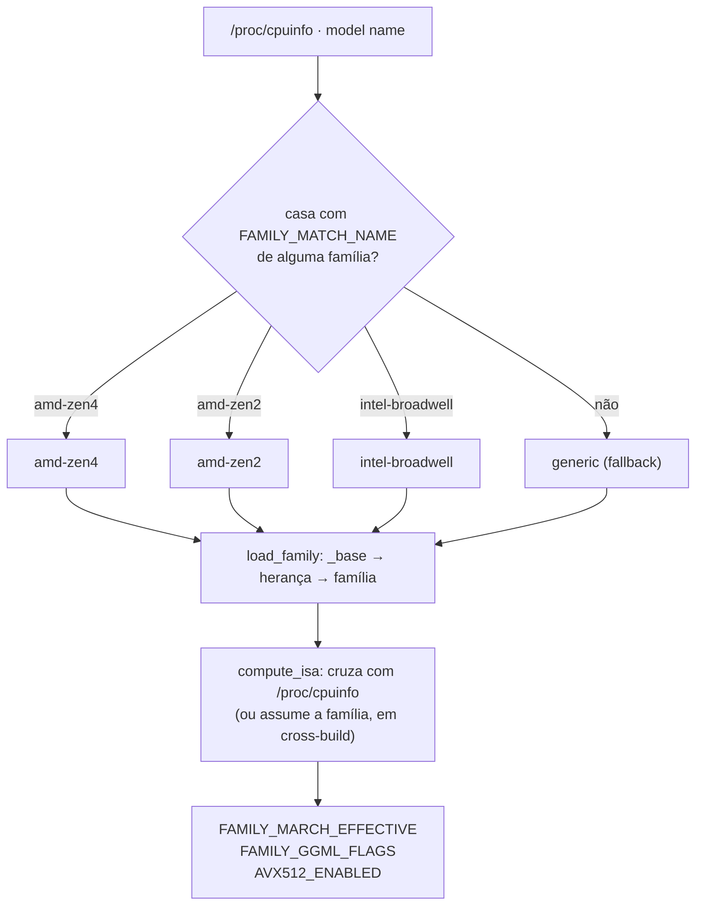

# docs/FAMILIES.md — Suporte por FAMÍLIA de CPU

> **Por que este documento existe.** Antes, o projeto suportava *um processador*
> (um único Xeon + um único Ryzen). Isso é fechado e desperdiça tempo: a
> otimização de uma microarquitetura vale para **dezenas de modelos**. Otimizar
> o Broadwell-EP (E5-2680 v4) beneficia automaticamente o E5-2620 v4, o
> E5-2660 v4… e o mesmo tuning de Haswell-EP vale para toda a família **v3**.
>
> Aqui o suporte é organizado por **família de microarquitetura**, com
> **herança** entre famílias.

---

## 1. Os três conceitos (não misture)

| Conceito | Responde | Onde vive | Exemplo |
|---|---|---|---|
| **Família** | *Quem é o hardware* → define `-march` e ISA | `families/<id>/family.conf` | `intel-broadwell` |
| **Papel** | *Para que serve a máquina* → define o que instalar | `roles/<id>/install.sh` | `inference`, `builder` |
| **Mod** | *Uma modificação isolada e reversível* | `mods/<id>/` | `openblas-threads` |

**Regra:** a família cuida de **CPU/ISA**. O papel cuida de **software/serviço**.
Nunca coloque ISA num papel, nem serviço numa família. Assim uma máquina
`amd-zen2` + papel `builder` e uma `amd-zen2` + papel `inference` compartilham
exatamente o mesmo build do llama.cpp.

---

## 2. Famílias disponíveis

| ID | Microarquitetura | `-march` | GCC mín. | AVX-512 | Herda de |
|---|---|---|---|---|---|
| `intel-haswell` | Haswell-EP (Xeon E5 **v3**) | `haswell` | qualquer | nunca | — |
| `intel-broadwell` | Broadwell-EP (Xeon E5 **v4**) | `broadwell` | qualquer | nunca | `intel-haswell` |
| `intel-skylake-avx512` | Skylake-SP / Cascade Lake (Scalable **v5/v6**) | `skylake-avx512` | 6 | **opt-in** | `intel-broadwell` |
| `amd-zen1` | Zen / Zen+ (Ryzen **1000/2000**) | `znver1` | 6 | nunca | — |
| `amd-zen2` | Zen 2 (Ryzen **3000/4000**) | `znver2` | 9 | nunca | `amd-zen1` |
| `amd-zen3` | Zen 3 (Ryzen **5000/6000**) | `znver3` | 11 | nunca | `amd-zen2` |
| `amd-zen4` | Zen 4 (Ryzen **7000/8000/9000**, EPYC Genoa/Siena) | `znver4` | 13 | nunca | `amd-zen3` |
| `generic` | qualquer x86-64 | *(nenhum)* | — | **auto** | — |

> A série **8000** de desktop/APU (8500G, 8600G, 8700G, 8845HS) é **Zen 4** — um
> caso que já escapou para o `generic` antes do corpus existir (§ 9.2).
> E **EPYC 9005 (Turin)** é Zen 5: pousa aqui por decisão deliberada (§ 9.4).

> Um `-march` novo demais faz o compilador **rejeitar** a flag. Por isso cada
> família declara `FAMILY_MARCH_MIN_GCC` e um `FAMILY_MARCH_FALLBACK`: o
> `resolve.sh` consulta `gcc -dumpversion` e usa o fallback (avisando) em vez de
> quebrar o build.

---

## 3. Como a família é escolhida



A ordem de teste é do mais específico para o mais genérico:
`amd-zen4 → amd-zen3 → amd-zen2 → amd-zen1 → intel-skylake-avx512 →
intel-broadwell → intel-haswell → generic`.

Ver a decisão sem aplicar nada:

```bash
bash families/resolve.sh                 # relatório completo
bash families/resolve.sh --quiet         # só FAMILY=<id>
bash build.sh --list-families            # tabela das famílias
./detect-hardware.sh --quiet             # FAMILY= e ROLE=
```

---

## 4. Herança: o ponto central

`FAMILY_INHERITS` monta uma cadeia carregada de `_base` até a folha, em que
**cada nível sobrescreve o anterior**:

```text
families/_base/family.conf          (padrões de todos)
   └─ intel-haswell                  -march=haswell,  AVX2, policy=never
        └─ intel-broadwell           -march=broadwell (o resto herda)
             └─ intel-skylake-avx512 -march=skylake-avx512, policy=optin
```

Consequência prática: **corrigir o tuning em `intel-haswell` corrige também
Broadwell e Skylake-SP**, a menos que a família filha declare o contrário. Foi
exatamente o pedido que originou esta camada: *"as melhorias do Xeon 2680 v4
beneficiarão o 2620 v4 e, se evoluir, servirá à família v3"*.

O `load_family()` tem proteção contra ciclo (guarda de 16 níveis) para que um
`FAMILY_INHERITS` circular não trave a máquina.

---

## 5. Política de AVX-512 (`FAMILY_AVX512_POLICY`)

O projeto **não proíbe** AVX-512 para sempre — ele impede que ele seja ligado
**por acidente**. Três políticas:

| Política | Comportamento | Usada por |
|---|---|---|
| `never` | Nunca liga, mesmo se a CPU tiver | Haswell, Broadwell, Zen 1–4 |
| `optin` | Só liga com `--allow-avx512` **e** flag presente (ou família assumida) | Skylake-SP |
| `auto` | Liga se a CPU reportar `avx512f` | `generic` |

Como o AVX-512 é um *exemplo* dessa lógica, o mesmo mecanismo serve para AMX
(`-DGGML_AMX=ON` só entra quando a flag existe).

**Regra que continua valendo (AGENTS.md, regra 12):** nunca escreva
`-mavx512*` fixo em código, script ou imagem. O caminho é sempre
família → política → verificação em runtime → opt-in explícito.

```bash
# Ligar AVX-512 numa máquina Skylake-SP (se você confirma que é o alvo):
sudo bash llama-build.sh --family intel-skylake-avx512 --allow-avx512
```

---

## 6. Cross-build: `--assume-family-isa`

Quando o build acontece em **outra** máquina (o runner do CI, por exemplo), olhar
o `/proc/cpuinfo` local é *errado*: ele descreve o construtor, não o alvo.

Foi assim que o CI caía no bug clássico: `GGML_NATIVE=ON` num runner com AVX-512
gerava um binário que sofreria **SIGILL** nos alvos reais (E5 v3/v4 e Ryzen
3500X têm apenas AVX2).

A correção tem duas partes:

1. O padrão do `llama-build.sh` é **`GGML_NATIVE=OFF`** + flags **explícitas** da
   família → o artefato fica portátil dentro da família.
2. `--assume-family-isa` faz a decisão de ISA vir do `family.conf` em vez do
   `/proc/cpuinfo` → o binário do CI corresponde ao alvo, não ao runner.

```bash
# CI/release (para outra máquina):
bash llama-build.sh --family intel-broadwell --assume-family-isa --yes
# build na própria máquina (máxima ISA possível):
bash llama-build.sh --native
```

O `llama-build.sh` grava um `AI-CPU-OS-BUILD.txt` ao lado dos binários com
família, `-march`, ISA, se o AVX-512 entrou e se o build foi nativo ou portátil —
para você auditar a portabilidade sem adivinhar.

---

## 7. Como adicionar uma família nova

```bash
mkdir -p families/amd-zen5
$EDITOR families/amd-zen5/family.conf
bash build.sh --list-families        # confira que apareceu
bash families/resolve.sh --family amd-zen5   # teste o carregamento
```

`family.conf` mínimo (tudo o resto vem de `_base` e da herança):

```bash
FAMILY_ID="amd-zen5"
FAMILY_NAME="AMD Zen 5 (Ryzen 9000, EPYC Turin)"
FAMILY_VENDOR="amd"
FAMILY_ARCH="x86_64"
FAMILY_INHERITS="amd-zen4"          # herda o tuning da geração anterior
FAMILY_MARCH="-march=znver5 -mtune=znver5"
FAMILY_MARCH_MIN_GCC="14"           # GCC precisa conhecer znver5
FAMILY_MARCH_FALLBACK="-march=znver4 -mtune=znver4"
FAMILY_ISA_REQUIRED="avx avx2 fma f16c"
FAMILY_ISA_OPTIONAL="avx512f avx512vnni"
FAMILY_AVX512_POLICY="optin"        # Zen 5 tem AVX-512: opt-in, não automático
FAMILY_MATCH_NAME="Ryzen .* (9[0-9]{3}|1[0-9]{4})|EPYC .* [0-9]{3}5"
FAMILY_CPUID_HINT="family 26 (0x1A)"
FAMILY_NOTES="..."
```

**Checklist antes de commitar uma família nova:**

1. `FAMILY_MATCH_NAME` não rouba CPUs de uma família anterior (teste vários
   nomes reais; o casamento é por ERE sobre o `model name`).
2. `FAMILY_MARCH_MIN_GCC` é o GCC em que a flag passou a existir **e** existe um
   `FAMILY_MARCH_FALLBACK` utilizável.
3. `FAMILY_AVX512_POLICY` é `never`/`optin` — `auto` só para `generic`.
4. Adicione `families/<id>/family.conf` à lista `required` do workflow
   `validate.yml` e à tabela deste documento.

---

## 8. Campos do `family.conf`

| Campo | Obrigatório | Papel |
|---|---|---|
| `FAMILY_ID` | sim | identificador (= nome da pasta) |
| `FAMILY_NAME` | sim | nome legível (aparece nos relatórios) |
| `FAMILY_VENDOR` | não | `intel` / `amd` / `generic` |
| `FAMILY_ARCH` | não | `x86_64` |
| `FAMILY_INHERITS` | não | id da família-pai (cadeia de herança) |
| `FAMILY_MARCH` | não | `-march`/`-mtune` (`""` = usa a ISA detectada) |
| `FAMILY_MARCH_MIN_GCC` | não | GCC mínimo que aceita o `-march` (`0` = qualquer) |
| `FAMILY_MARCH_FALLBACK` | não | `-march` alternativo se o GCC for antigo |
| `FAMILY_ISA_REQUIRED` | sim | flags que a família deve ter (`+flag`/`-flag` no relatório) |
| `FAMILY_ISA_OPTIONAL` | não | flags extras aproveitáveis |
| `FAMILY_AVX512_POLICY` | sim | `never` \| `optin` \| `auto` |
| `FAMILY_MATCH_NAME` | sim* | ERE casado contra o `model name` (`""` = fallback) |
| `FAMILY_CPUID_HINT` | não | documentação (family/model do CPUID) |
| `FAMILY_NOTES` | não | observações das armadilhas daquela família |

\* `generic` é a única com `FAMILY_MATCH_NAME=""` — ela é o fallback.

---

## 9. Testes e status de validação

### 9.1 O corpus (`tests/test-families.sh`)

O projeto mantém um **corpus de ~60 modelos de CPU reais** em
`tests/families-matrix.txt`, no formato `<família-esperada>|<model name>`. O
teste roda a **mesma função que o build usa** (`pick_family`) e compara.

```bash
bash tests/test-families.sh              # roda o corpus (não precisa de hardware)
bash tests/test-families.sh --verbose    # mostra também os acertos
make families-test                       # atalho (roda no CI, job 'validate')
```

Ele também aceita teste manual avulso, quando quiser sondar um modelo:

```bash
bash families/resolve.sh --quiet                      # FAMILY=<id>
bash families/resolve.sh --family amd-zen2 --allow-avx512   # política/força
```

**O que este teste prova:** a *regra de seleção* — que o regex de cada família
casa com os modelos certos e não rouba os dos outros. **O que ele NÃO prova:**
ISA nem `-march` em execução. Isso só um CPU de verdade prova.

### 9.2 O que já foi pego por ele

Vale registrar, porque justifica o teste existir:

| Bug | Efeito |
|---|---|
| `EPYC .* [0-9]{3}1` (espaço a mais) | **Nenhum EPYC casava** — todos caíam em `generic`. Naples, Rome, Milan, Genoa, Siena: todos. |
| Zen 4 sem a série 8000 | Ryzen 8500G/8600G/8700G/8845HS (que **são Zen 4**) caíam em `generic`. |
| Zen 4 sem EPYC Genoa/Siena | `EPYC 9554`, `EPYC 8324P` caíam em `generic`. |

Nenhum desses apareceria num teste de compilação: o build *funciona* com
`generic`, só que sem `-march` — o silêncio que custa desempenho.

### 9.3 Status por família

Legenda: **corpus** = casamento exercitado por `make families-test`;
**compile** = `build-llama` do CI compila para a família (`--assume-family-isa`
+ `--gcc` do runner); **hardware** = validado num CPU físico.

| Família | corpus | compile (CI) | hardware | Observação |
|---|---|---|---|---|
| `intel-haswell` (E5 v3) | ✅ | ✅ | ❌ | alvo histórico do projeto |
| `intel-broadwell` (E5 v4) | ✅ | ✅ | ❌ | **alvo atual** (E5-2680 v4) |
| `intel-skylake-avx512` (v5+) | ✅ | ✅ | ❌ | AVX-512 por opt-in; cobre v5–v8 e futuros |
| `amd-zen1` (1000/2000) | ✅ | ✅ | ❌ | inclui APUs |
| `amd-zen2` (3000/4000) | ✅ | ✅ | ❌ | **alvo atual** (Ryzen 5 3500X) |
| `amd-zen3` (5000/6000) | ✅ | ✅ | ❌ | exercitado no CI **sem** hardware |
| `amd-zen4` (7000/8000/9000) | ✅ | ✅ | ❌ | ⚠️ exige GCC ≥ 13 para `znver4` |
| `generic` | ✅ | ❌ | ❌ | fallback; sem `-march` |

**O que "pronto" quer dizer aqui, sem engano:** as famílias Zen 3 e Zen 4 estão
**prontas para uso** no sentido de que (a) o casamento CPU → família é
verificado por teste, (b) o CI **compila** um binário para elas, e (c) o
`-march` tem fallback automático para GCC antigo. O que **não** existe é
medição em hardware Zen 3/4 — então trate-as como *suportadas e não medidas*,
não como *recomendadas*.

> Para validar Zen 3/4 de verdade: rode `bash families/resolve.sh` e
> `sudo ./build.sh --dry-run` na máquina e preencha o **Bloco N** de
> `docs/VALIDATION.md`. É o que falta para tirar o ❌ da coluna "hardware".

### 9.4 Nota sobre Zen 5 e o `-march`

Zen 5 (Ryzen 9000 desktop, EPYC 9005/Turin) **pousa em `amd-zen4`** hoje, por
decisão deliberada: o GCC 14 já conhece `znver5`, mas o projeto prefere um
`-march` mais antigo e previsível a um que pode não existir no compilador do
usuário. Quando a validação acompanhar, o caminho é criar `families/amd-zen5/`
com `FAMILY_INHERITS="amd-zen4"` — a herança faz o resto (ver § 7).
